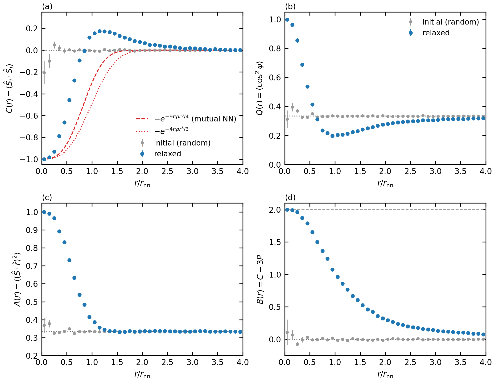

# gr-spin-frustration

[](https://github.com/kdemirel/gr-spin-frustration/actions/workflows/ci.yml)
[](LICENSE)


Zero-temperature relaxation of classical spins fixed at random (Poisson) positions and coupled by the
**general-relativistic spin-spin interaction**, and the ensemble analysis of their pair correlations.
Two spins interacting through this tensor force prefer to be antiparallel along the line joining them;
in a random many-body geometry these pairwise preferences cannot all be satisfied, and the relaxed state is a
geometrically frustrated spin texture. This package simulates that state and measures it.

The code accompanies a manuscript in preparation.

<p align="center">
  
</p>

*Example output of `grspin` for a modest demo run (N = 2000, 24 realizations; regenerate with
`scripts/make_readme_figure.py`). It is not the production ensemble of the paper.*
Distances are in units of the mean nearest-neighbour distance `r_nn`; gray: random initial spins, blue: relaxed;
dashed/dotted red: nearest-neighbour references.

## Physics in brief

For classical spins `S_i` (fixed length, free direction) the pair energy is

```
U_ij = -(G / r^3) [ S_i . S_j - 3 (S_i . rhat)(S_j . rhat) ],     H = sum_{i<j} U_ij
```

The ground state of an isolated pair is `u_i . u_j = -1` with both spins along the bond. Written in the
components along and transverse to the bond, `U_ij = -(G / r^3) [ S_perp,i . S_perp,j - 2 S_r,i S_r,j ]`:
the longitudinal components couple antiferromagnetically, the transverse ones ferromagnetically. The
relaxation sets every spin, sweep after sweep, to the direction of its local field `h_i = sum_j T_ij S_j`
(an exact minimization over that spin's direction, so the energy never increases) until a low-energy
metastable configuration is reached. The measured observables are the radial spin correlation
`C(r) = <u_i . u_j>`, its longitudinal and transverse channels `P(r) = <(u_i . rhat)(u_j . rhat)>` and
`Cperp = C - P`, the axis locking of the pair total spin `Q(r) = <cos^2 phi>`, the single-spin axis
alignment `A(r)`, the tensor (pair-energy) correlation `B(r)`, the correlation map of third spins in the
frame of the nearest-neighbour dimers and the spin structure factor `S(k)`.

The code implements the family `H = -sigma G sum_{i<j} r^-3 [S_i . S_j - gamma (S_i . rhat)(S_j . rhat)]`,
in which `gamma - 1` is the weight of the longitudinal channel relative to the transverse one (GR:
`gamma = 3`). Besides the sign-reversed controls (`isotropic_afm`, `dipolar`) it offers the channel
controls `gamma = 1, 12, 100` (`transverse_only`, `gamma12`, `longitudinal_only`; the overall scale is
irrelevant at `T = 0`, so `gamma = 100` is longitudinal-only to 1 %), and the positions can carry a
hard core (minimum separation by sequential random addition) instead of being an ideal Poisson
process. Details, definitions and validation: [docs/METHODS.md](docs/METHODS.md).

## Installation

```bash
git clone https://github.com/kdemirel/gr-spin-frustration.git
cd gr-spin-frustration
python -m venv .venv && source .venv/bin/activate     # Python >= 3.10
pip install -e ".[dev]"                                # numpy, scipy, pandas, matplotlib, numba (+ pytest, ruff)
pytest -q                                              # ~15 s; numba compiles the kernels on first use
```

## Quick start

### Command line

```bash
# 20 realizations of 5000 spins, 100 sweeps, 4 worker processes; analyse afterwards
grspin run -N 5000 -R 20 --n-sweeps 100 --out results/demo -j 4 --analyze

# the same run, extended to 100 realizations (finished ones are skipped)
grspin run -N 5000 -R 100 --n-sweeps 100 --out results/demo -j 4

# control experiment on identical geometries: sign-reversed tensor (dipolar magnet)
grspin run -N 5000 -R 20 --n-sweeps 100 --coupling dipolar --out results/demo_dipolar -j 4
grspin compare results/demo results/demo_dipolar --labels GR dipolar --out results/compare

# channel control on the same geometries: transverse channel only (sigma = +1, gamma = 1)
grspin run -N 5000 -R 20 --n-sweeps 100 --coupling transverse_only --out results/demo_gamma1 -j 4

# hard-core positions: all pair distances >= 0.5 r_nn (sequential random addition; unpaired with the above)
grspin run -N 5000 -R 20 --n-sweeps 100 --min-separation-nn 0.5 --out results/demo_hardcore -j 4
```

| command | what it does |
|---|---|
| `grspin run` | run, resume or extend an ensemble of independent realizations |
| `grspin analyze` | tables, landmarks with bootstrap errors and an error budget, channel decomposition, dimer-frame map and dimer-field test, `S(k)`, energy budget / frustration index, figures |
| `grspin compare` | overlay figure, landmark table and paired (or unpaired) differences of several runs; landmarks against `gamma` for the channel family |
| `grspin protocol-check` | compare update orders, initial states and Metropolis annealing on identical systems |
| `grspin benchmark` | time one realization and compare with the cost model |
| `grspin plan ...` | the simulation plan: `list`, `show`, `status`, `provenance`, `run`, `analyze`, `markdown` |

`grspin <command> --help` lists all options.

### Python

```python
from grspin import SimulationConfig
from grspin.analysis import EnsembleData
from grspin.ensemble import run_ensemble
from grspin.plotting import figure_overview, save_figure


def main():
    config = SimulationConfig(n_particles=2000, n_sweeps=100, n_bins=80, n_realizations=24)
    run_ensemble(config, "results/example", n_workers=-1)

    data = EnsembleData.load("results/example")
    print(data.table(rebin=2).head())  # pandas DataFrame, one row per radial bin
    print(data.landmarks(rebin=2)["C_peak"])  # value and bootstrap error of the positive peak
    save_figure(figure_overview(data, rebin=2), "overview.pdf")


# Required when n_workers > 1: macOS and Windows start worker processes by spawning.
if __name__ == "__main__":
    main()
```

A notebook version is in [notebooks/quickstart.ipynb](notebooks/quickstart.ipynb).

## The simulation plan

Every run needed for the manuscript is defined in code ([src/grspin/plan.py](src/grspin/plan.py)) and listed
as a checklist in **[docs/SIMULATION_PLAN.md](docs/SIMULATION_PLAN.md)**:

| set | purpose |
|---|---|
| `M` | main ensemble: `C, P, Cperp, Q, A, B`, landmarks with error budget, nearest-neighbour diagnostics, dimer-frame map and dimer-field test, `S(k)` and energy budget (48 stored states) |
| `S1` | convergence with the number of relaxation sweeps |
| `S2` | dependence on the interaction cutoff |
| `S3` | finite size and open versus periodic boundaries |
| `S4` | distribution of spin lengths |
| `S5` | protocol / metastability check (update order, initial state, annealing), including `S5_N5000` at production size on the seeds of `M` |
| `S6` | control couplings (isotropic antiferromagnet, sign-reversed tensor), 16 stored states each (energy budget with the control's own two-body minimum) |
| `S7` | channel controls: `sigma = +1` with `gamma = 1, 12, 100` (transverse only, 11 : 1, longitudinal only) on the seeds of `M` - which channel carries the positive shell? `cmp_channels` tabulates the landmarks against `gamma` |
| `S8` | hard-core positions (minimum separation 0.5 r_nn by sequential random addition; compared unpaired with `M`) |
| `T` | far tail of `C, P, Cperp` out to 10 r_nn at `r_cut = 7, 10, 15 r_nn` (N = 10000) and N = 20000: the far-tail dip is a truncation effect; 16 stored states each for `S(k)` versus `r_cut` (`cmp_structure_factor`) |

The derived items `D1`-`D3` (nearest-neighbour diagnostics and binning; error budget, dimer-frame map,
`S(k)` and energy budget; channel controls and dimer-field test) need no new simulation.

```bash
grspin plan list                      # entries with estimated cost
grspin plan run all --smoke -j 4      # the whole plan in miniature (~25 s, plus ~40 s for `plan analyze --smoke`)
grspin plan run required -j 8         # production runs (finished realizations are skipped)
grspin plan status                    # progress from the files on disk (stale-config: the plan changed)
grspin plan run S5 --refresh-stale    # recompute entries whose stored configuration differs from the plan
grspin plan analyze                   # analysis of everything that is finished, plus comparisons
grspin plan provenance                # commit / dirty flag / source hash of every entry versus the current tree
```

## Output layout

```
results/<id>/config.json               configuration, provenance (versions, platform, git commit, dirty flag,
                                       git diff of the sources if dirty, SHA-256 of the sources), run history
results/<id>/seeds/seed_XXXXXXXX.npz   one file per realization: binned sums/counts, histories, diagnostics,
                                       dimer-frame map (with --nn-diagnostics), annealing acceptance per
                                       temperature (--protocol anneal), git commit and source hash
results/<id>/protocol/...              one file per realization of a protocol check (overlaps and energies,
                                       also split into dimer and interstitial spins)
results/<id>/states/...                optional positions and spins of the first realizations
results/<id>/analysis/                 summary.md/json, ensemble_table.csv (C, P, Cperp, Q, A, B), histories.csv,
                                       error_budget.csv, fit.json, nn_*.csv, dimer_map.csv, dimer_angular.csv
                                       (with the dimer-only prediction C_pred), dimer_field.csv, structure_factor.csv,
                                       energy_budget.csv/json (dimer share, frustration index), figures (C_of_r,
                                       decomposition, Q_A_of_r, overview, histories, nn_diagnostics, dimer_map,
                                       structure_factor; pdf/png); protocol_summary.csv/md for protocol checks
results/_comparisons/<id>/             comparison tables, overlays, landmark differences and paired or
                                       unpaired bin-wise differences; gamma_family.csv/pdf for cmp_channels;
                                       structure_factor_vs_cutoff.csv and structure_factor_comparison.pdf/md
                                       under cmp_structure_factor
```

Results are not committed (`results/` is git-ignored); `config.json` plus the code version reproduce them.

## Performance

Cost per realization is dominated by the neighbour list (`E = N (4 pi / 3) rho r_cut^3` directed edges):
about `2.5e-7 s` per edge to build and `2.3e-9 s` per edge and sweep, with `~250 MB + 220 B` per edge of
peak memory. On a laptop core, `N = 5000`, `r_cut = 10 r_nn`, 100 sweeps take ~2 s (plus 0.2 s for the
`O(N^2)` sequential random addition of hard-core positions); the complete plan is
roughly 1.4 core-hours, of which the far-tail set `T` takes 0.3 (`N = 10000` with `r_cut = 15 r_nn` needs
~5.5 GB per worker, so it runs with a single worker on a 16 GB machine, ~8 min) and the protocol check
`S5_N5000` 0.15. `grspin run` limits the workers so that their estimated memory stays below half of the
RAM (`--max-memory-gb`).

## Reproducibility

* realization `k` uses seed `base_seed + k`; results are independent of the number of workers and
  bit-for-bit reproducible, so recomputing an entry only renews its provenance stamps;
* the random stream matches the earlier prototype scripts, and a regression test ties the package to them;
* every `config.json` records package/library versions, the platform, the git commit (with the diff of the
  sources if the tree was dirty) and a SHA-256 hash of the package sources; every realization file carries
  the commit and the hash, and `grspin plan provenance` compares them with the current tree;
* the kernels use strict IEEE arithmetic (no `fastmath`).

## Development

```bash
pytest -q                 # test suite
ruff check . && ruff format --check .
grspin plan markdown --write docs/SIMULATION_PLAN.md   # after changing src/grspin/plan.py
```

See [CONTRIBUTING.md](CONTRIBUTING.md) and [CHANGELOG.md](CHANGELOG.md).

## Project layout

```
src/grspin/
    config.py        configuration, units, couplings (channel family, two-body minima), cost model
    initial.py       Poisson or hard-core (sequential random addition) positions, isotropic spins,
                     spin-length distributions
    neighbors.py     CSR neighbour lists, periodic (minimum image) or open
    kernels.py       numba: sweeps, energy, Metropolis (acceptance per temperature)
    relax.py         relaxation driver (quench, annealing schedule), incremental energy
    observables.py   C, Q, A, P, B, global spin diagnostics, dimer-frame map, structure factor
    nn.py, theory.py nearest-neighbour diagnostics and exact Poisson results
    ensemble.py      parallel, resumable ensemble runner; provenance (commit, source hash, diff)
    analysis.py      statistics over realizations, bootstrap, landmarks on x_mean, error budget,
                     paired/unpaired differences, dimer map, S(k)
    fit.py           damped-oscillatory guide for C(r) (not used quantitatively)
    protocols.py     protocol / metastability check
    plan.py          the simulation plan (data), status, provenance report, checklist generator
    plotting.py, report.py, cli.py
tests/               pytest suite (~40 s)
docs/                METHODS.md, SIMULATION_PLAN.md
notebooks/           quickstart notebook
scripts/             regeneration of the README figure
```

## Citation

If you use this code, please cite it via [CITATION.cff](CITATION.cff) (GitHub's "Cite this repository");
the article will be added once published.

## License

MIT, see [LICENSE](LICENSE).
